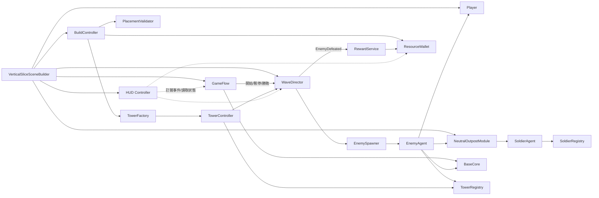
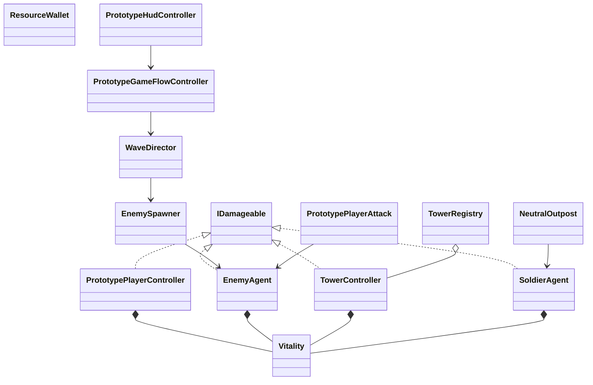

# CyberWizard TD 後續開發指南

> 給接手開發人員的快速導覽。完整遊戲規格與數值請看 [`開發規劃.md`](開發規劃.md)。
>
> **2026-11-28 註記**：本文件描述的 VerticalSlice 場景、場景產生器、建塔流程與 UI Toolkit HUD 已刪除；專案也已從 `Assets/_Project/` 搬到 `Assets/`。以下只更新仍存在的路徑，企劃內容未修改。目前的實作狀態以 `Docs/IMPLEMENTATION_REPORT.md` 為準。

## 1. 先從這裡開始

- Unity：`2022.3.62f3`，URP 14。
- 主場景：`Assets/_Project/Scenes/VerticalSlice.unity`（已刪除；目前關卡為 `Assets/Scenes/Level_1.unity`，流程場景為 `MainMenu`、`LevelSelect`）。
- 場景產生器：`Assets/_Project/Editor/VerticalSliceSceneBuilder.cs`（已刪除；目前場景直接編輯）。
- 執行碼：`Assets/Scripts`，統一在 `CyberWizard.Runtime.asmdef`。
- 關卡波次：`Assets/StreamingAssets/Levels/*.json`。
- UI Toolkit：`Assets/_Project/UI/PrototypeHud.uxml`、`PrototypeHud.uss`（已刪除；目前 HUD 為 IMGUI，選單與面板為 uGUI）。
- 測試：`Assets/Tests/EditMode`、`PlayMode`。

第一次開啟或修改場景組裝內容後，執行：

```text
Unity 選單 > CyberWizard > Build Vertical Slice Scene
```

重要：`VerticalSliceSceneBuilder` 會重建主場景，並建立／更新敵人、塔與材質資產。地圖、預設數值或依賴關係若需要永久修改，應先修改 Builder，而不是只手改 Scene 或生成的資產。

## 2. 目前可玩內容

- 固定肩後第三人稱相機，滑鼠控制視角。
- 玩家可移動、射擊、建塔、升級、修復；死亡 3 秒後回基地。
- 四元素 × 單體／範圍，共 8 種塔。
- 兩座可開關的中立基地；玩家或敵人可佔領並在波次中生產士兵。
- 每波結束清除士兵。
- 兩份 JSON 關卡，每關 5 波，開始時間為 `30/55/80/105/130` 秒。
- 玩家基地歸零時失敗；所有波次清除時勝利。
- UI 按鈕只接受滑鼠點擊，不接受鍵盤焦點觸發。

## 3. 專案目錄

```text
Assets/                                  # 原為 Assets/_Project/；標示（已刪除）者已不存在
├─ Editor/VerticalSliceSceneBuilder.cs   # （已刪除）場景與預設資產組裝入口
├─ Data/
│  ├─ Enemies/                           # EnemyDefinition 資產
│  └─ Towers/                            # 8 種 TowerDefinition 資產
├─ Scenes/VerticalSlice.unity             # （已刪除）
├─ Scripts/
│  ├─ Core/                              # Faction、GamePhase、IDamageable、Vitality
│  ├─ Data/                              # 敵人與 JSON DTO／解析
│  ├─ Gameplay/                          # 實際遊戲規則
│  ├─ Infrastructure/                    # JSON 載入
│  └─ Presentation/                      # 相機、HUD、材質、血條與視覺效果
├─ Tests/                                # EditMode / PlayMode
└─ UI/                                   # （已刪除）

Assets/StreamingAssets/Levels/           # 關卡 JSON
Ref/                                    # 規格與交接文件
```

## 4. 啟動與物件組裝

Builder 產生下列主要場景物件：

```text
Main Camera
  └─ PrototypeCameraFollow
Player
  ├─ CharacterController
  └─ PrototypePlayerController
Prototype Systems
  ├─ ResourceWallet / TowerRegistry / SoldierRegistry
  ├─ EnemySpawner / WaveDirector / RewardService
  ├─ PrototypeBuildController / PrototypeComboSystem
  ├─ PrototypePlayerAttack / PrototypeGameFlowController
  └─ PrototypeAudioService / PrototypeMvpSmokeDriver
Prototype Environment
  ├─ Ground / 邊界
  ├─ Player Base + BaseCore
  └─ Enemy Base + 生成點
Neutral Outpost Module
  └─ NeutralOutpost × 2
Prototype HUD
  ├─ UIDocument
  └─ PrototypeHudController
```

目前沒有全域 Singleton。Builder 建立元件後呼叫 `Configure(...)` 注入依賴；新增必要服務時，要同步修改 Builder 的建立順序和 Configure 參數。

## 5. 系統架構圖



## 6. 核心類別關係



## 7. 主要實現方式

### 流程與波次

- `PrototypeGameFlowController` 管理 `Ready → Wave → Paused / Ended / Defeat`。
- `LevelScheduleLoader` 讀取 StreamingAssets JSON，`LevelScheduleParser` 驗證資料。
- `WaveDirector` 以 `startTime` 絕對時間啟動波次；上一波未清除不會阻擋下一波。
- 重要事件：`WaveBegan`、`WaveCleared`、`EnemyDefeated`、`AllWavesCompleted`。

### 戰鬥與生命

- 可受傷物件實作 `IDamageable`，生命統一交給 `Vitality`。
- 玩家／敵人／士兵使用 `CombatProjectile`；塔使用可池化的 `TowerProjectile`。
- 敵人和士兵使用 `GroundGravity`；玩家重力由 CharacterController 垂直速度處理。
- 世界血條由 `WorldHealthBar` 以基本幾何建立。

### 敵人

- `EnemyDefinition`：生命、速度、傷害、獎勵、攻擊間隔和原型外觀。
- `EnemySpawner`：以穩定 ID 找定義並建立敵人。
- `EnemyAgent`：協調生命週期與意圖。
- `EnemyIntentSelector`：出生時決定攻基地、攻塔或佔領中立基地。
- `EnemyMovementMotor`、`EnemyMeleeAttack`：分別處理水平移動與攻擊冷卻。

### 塔與建造

- `TowerDefinition`：塔的元素、攻擊模式及數值。
- `PrototypeBuildController`：輸入、預覽、扣款、修理與升級。
- `TowerPlacementValidator`：地面、道路、間距、塔上限和金錢驗證。
- `TowerFactory`：建立 Base／Body／Top 幾何與 `TowerController`。
- `TowerRegistry`：追蹤塔、上限及全塔射程顯示。
- 射程以 `PrototypeRangeCircle` 的 LineRenderer 圓線呈現。

### 中立基地

- `NeutralOutpostModule`：統一開關及查找可佔領基地。
- `CaptureZone`：玩家佔領進度。
- `NeutralOutpost`：控制權、波次事件、士兵生產與每波結束清除。
- `SoldierRegistry`：雙方士兵查詢。

### UI

- 結構／樣式在 UXML、USS；狀態與按鈕事件在 `PrototypeHudController`。
- UI 訂閱系統事件，在 `OnDisable` 必須解除訂閱。
- 所有 Button 都必須設定 `focusable=false`、`tabIndex=-1`，避免鍵盤觸發。
- 遊戲規則不可寫進 HUD；HUD 只呼叫公開操作或顯示狀態。

## 8. 常見擴充作業

### 新增敵人

1. 建立／更新 `EnemyDefinition`。
2. 在 Builder 的 `CreateEnemyDefinitions()` 註冊。
3. 在關卡 JSON 使用相同 `enemyTypeId`。
4. 補解析或數值測試。

### 新增塔

1. 擴充 `TowerDefinition` 或建立新資產。
2. 在 Builder 的 `CreateTowerDefinitions()` 註冊。
3. 更新建造選擇方式與 HUD。
4. 若是新攻擊模式，優先擴充 `TowerController`／Projectile，不把規則寫進 Factory。

### 新增關卡

1. 在 `StreamingAssets/Levels` 新增 JSON。
2. 將路徑加入 Builder 建立 `PrototypeGameFlowController` 時的清單。
3. 確認所有敵人 ID、出生點 ID 都已註冊。
4. 增加 EditMode 解析與 PlayMode 選關測試。

### 修改地圖或預設數值

1. 修改 `VerticalSliceSceneBuilder`。
2. 重新執行 `Build Vertical Slice Scene`。
3. 檢查 Scene diff，避免誤刪手工內容。

### 新增可受傷單位

1. 實作 `IDamageable`。
2. 組合 `Vitality` 和 `WorldHealthBar`。
3. 若在地面移動，加入 `GroundGravity` 或 CharacterController 重力。
4. 註冊到適合的 Registry，並在 Destroy 時解除註冊／事件。

## 9. 事件與資料規則

- ScriptableObject／JSON 保存設計資料；執行期狀態留在 MonoBehaviour。
- 跨系統優先使用明確事件，不直接改其他系統私有狀態。
- Registry 公開唯讀集合，建立與摧毀時成對 Register／Unregister。
- 訂閱與解除訂閱必須成對，避免重玩或刪除物件後殘留 callback。
- 資源扣款一律使用 `ResourceWallet.TrySpend()`；建立失敗必須退款。
- 新 ID 必須穩定且唯一，修改既有 ID 時同步更新 JSON。

## 10. 測試與提交前檢查

目前基準：EditMode 10 項、PlayMode 1 項（已過時；最新數量與已知失敗項目請見 `Docs/IMPLEMENTATION_REPORT.md` 的驗證表）。

提交前至少執行：

1. Unity 無編譯錯誤。
2. `CyberWizard > Build Vertical Slice Scene` 成功。
3. EditMode、PlayMode 測試全數通過。
4. 開局、暫停、五波、勝利、基地失敗、重玩可成立。
5. Scene 沒有 Missing Script／Reference。
6. 檢查 `git diff`，確認沒有提交 `Library`、`Temp`、`Logs`、Build 產物。

## 11. 已知技術債

> 2026-11-27 更新：前四項已處理，細節見 `Docs/IMPLEMENTATION_REPORT.md` 最後一節。本文件其他段落仍描述已刪除的 VerticalSlice／Builder 架構，目前場景請以 `Assets/README.md` 為準。

- ~~Builder 同時負責資產、場景與依賴組裝，功能增加後應拆成數個 Editor 工具。~~ 不適用：Builder 已於 2026-11-26 刪除，`Level_1` 直接編輯場景。
- ~~多個控制器仍直接讀取舊版 `Input` API；後續可集中成輸入服務。~~ 已完成：所有輸入改由 `Scripts/Infrastructure/GameInput.cs` 讀取。
- ~~敵人與士兵用 Transform 水平移動，尚未使用 NavMesh。~~ 已完成：敵人改用 `NavMeshAgent`，NavMesh 由 `LevelNavMesh` 在執行時烘焙；士兵已刪除。
- ~~`GroundGravity` 每幀使用物理查詢，單位大量增加時應改為 NonAlloc 或 Rigidbody／NavMesh 方案。~~ 已解決：改用 NavMesh 後 `GroundGravity` 已刪除。
- 幾何模型、血條、音效與特效皆為原型實作，替換美術時不要改動核心規則。
- 目前測試偏重資料與啟動流程；玩家攻擊、重生、中立士兵、連攜和重力仍需更多 PlayMode 覆蓋。
