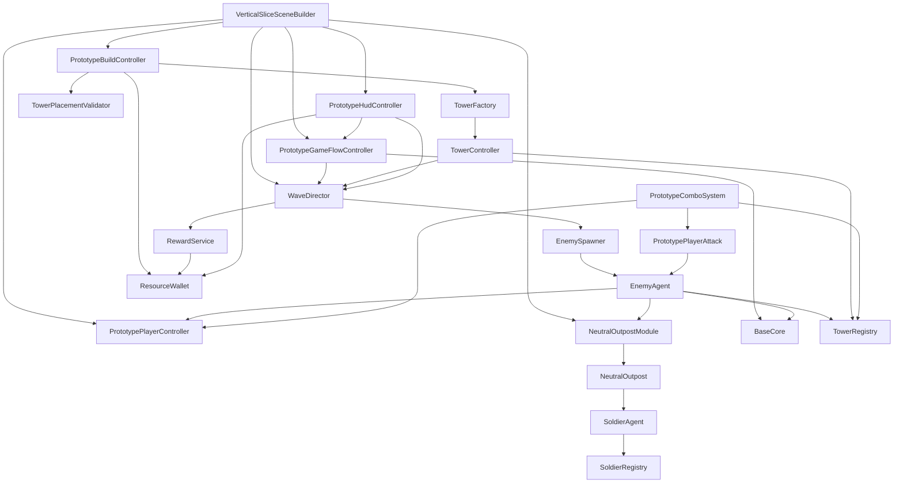
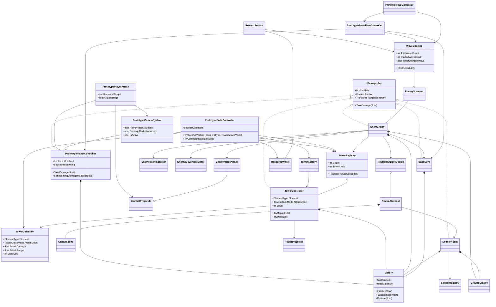

# CyberWizard TD 開發規劃

更新日期：2026-11-07

Unity：2022.3.62f3 / URP 14

目前目標：單人、五波、四角基地的可玩原型

## 1. 遊戲規格基準

### 地圖與陣營

- 地圖為 7 × 7 比例的正方形平面，目前以 70 × 70 Unity 單位實作。
- 玩家基地、敵人基地、兩座中立基地位於四個角落；玩家與敵人位於對角。
- 四座基地皆使用 5 × 2 × 5 的基本幾何模型。
- 玩家出生在玩家基地前方。
- 地圖深灰、玩家藍、敵人紅、中立淺灰；中立基地投靠後改為所屬陣營顏色。

### 關卡流程

```text
等待開始
  -> 點擊開始
  -> 30 秒自由整備
  -> 依 JSON 絕對時間啟動五波敵人
  -> 最後一波出現 Boss
  -> 所有波次與敵人清除：勝利
  -> 玩家基地歸零：失敗
  -> 再次遊玩
```

- 玩家死亡不造成失敗，3 秒後在玩家基地重生並恢復滿血。
- 波次不等待上一波清空；開始時間到達後直接產生。
- 中立士兵只在至少一個波次進行中時生產；所有波次結束後清除。

## 2. 目前數值

| 對象 | 生命 | 傷害 | 攻擊間隔 | 其他 |
|---|---:|---:|---:|---|
| 玩家 | 100 | 10 | 0.5 秒 | 圓形射程 3、左鍵攻擊 |
| Level 0 敵人 | 50 | 3 | 1 秒 | 擊殺 150 金錢 |
| Level 1 敵人 | 80 | 5 | 1 秒 | 擊殺 200 金錢 |
| Level 2 敵人 | 120 | 9 | 1 秒 | 擊殺 300 金錢 |
| Boss | 300 | 40 | 2 秒 | 擊殺 500 金錢 |
| 單體塔 | 150 | 20 | 0.8 秒 | 長射程 7 |
| 範圍塔 | 150 | 5 | 0.5 秒 | 射程 4、爆炸半徑 2 |
| 玩家基地 | 100 | — | — | 歸零時失敗 |

- 敵人攻擊距離為 1.5。
- 塔建造費用為 100，塔數上限為 10。
- 塔身等級 1 到 5；升級費用依序為 50、100、200、500。
- 依目前等級完整修復塔身的費用為 30、40、50、70、100。
- 初始金錢為 200。

## 3. 塔系統

四種元素各有兩種攻擊模式，共八種塔：

| 按鍵 | 元素 | 模式 | 塔頂顏色 |
|---:|---|---|---|
| 1 | 火 | 單體長射程 | 紅 |
| 2 | 火 | 範圍短射程 | 紅 |
| 3 | 水 | 單體長射程 | 淺藍 |
| 4 | 水 | 範圍短射程 | 淺藍 |
| 5 | 土 | 單體長射程 | 棕 |
| 6 | 土 | 範圍短射程 | 棕 |
| 7 | 風 | 單體長射程 | 淺綠 |
| 8 | 風 | 範圍短射程 | 淺綠 |

- 塔基與塔頂只負責外觀；塔身是生命、修理與升級的功能主體。
- 塔身為藍色，頂部球體使用元素顏色。
- `TowerDefinition` ScriptableObject 保存類型、元素、模式、生命、傷害、射程、間隔、彈速、範圍半徑與成本。
- `TowerFactory` 建立基本幾何外觀，`TowerController` 負責目標、冷卻、投射物、範圍傷害、生命、升級與修理。
- 範圍塔攻擊時顯示一秒作用範圍；`T` 可切換所有塔射程。

## 4. 玩家與連攜

### 玩家攻擊

- 非建造操作時，滑鼠左鍵對準射程內敵人即可發射藍色彈體。
- 玩家攻擊範圍以平面圓線永久顯示，塔與建造預覽也使用相同線段圓圈。
- 畫面中央永遠顯示白色 `+` 準心。
- 玩家、敵人、士兵與塔的攻擊皆使用可見投射物或明確的範圍脈衝。
- 玩家移動使用 CharacterController 垂直速度；敵人與士兵使用共用 `GroundGravity`，會落到碰撞地面。攻擊投射物不套用重力。

### 被動連攜

玩家同時位於兩座最近塔的射程內時：

- 同元素：玩家攻擊提高 50%。
- 不同元素：玩家受到傷害降低 50%。
- 兩座塔的塔頂以各自元素顏色的線連接玩家。
- 離開重疊區後立即取消效果。

舊版按 `Q` 施放火風、火地、水風技能的邏輯已移除，避免與目前規格並存。

## 5. 中立基地

- 中立功能由 `NeutralOutpostModule` 統一開關，僅能在開始前切換。
- 地圖固定有兩座 `NeutralOutpost`。
- 玩家進入範圍並停留 3 秒後，中立基地改為玩家控制。
- 敵人出生時有 15% 機率前往最近可佔領的中立基地；成功後改為敵方控制。
- 已投靠的基地每 3 秒生產一名所屬陣營士兵，數量上限暫定 10。
- 只有波次進行中才生產；每一波結束時立即清除當時所有士兵。若仍有重疊波次進行，之後可重新開始生產。

## 6. 敵人行為

敵人出生時由 `EnemyIntentSelector` 選擇一次主要意圖：

- 15%：佔領可用的中立基地。
- 15%：攻擊現有塔。
- 70%：朝玩家基地前進。

目標不存在或失效時回到進攻基地。敵人靠近活著的玩家時可先攻擊玩家。一般敵人抵達基地後造成一次傷害並退場；Boss 會留在基地旁持續攻擊。

## 7. 波次 JSON

資料位於：

- `Assets/StreamingAssets/Levels/level_01.json`
- `Assets/StreamingAssets/Levels/level_02.json`

每個 `wave` 包含：

- `waveId`：穩定識別碼。
- `startTime`：按下開始後的絕對秒數。
- `enemies[]`：敵人類型、數量、出生間隔、出生點。

目前兩關皆有五波，開始時間為 30、55、80、105、130 秒，每波相隔 25 秒；最後一波包含 `enemy_boss`。可用敵人 ID：

- `enemy_level0`
- `enemy_level1`
- `enemy_level2`
- `enemy_boss`

`WaveDirector` 依時間啟動波次，因此上一波未清除不會阻擋下一波。

## 8. 系統架構



## 9. 完整類別關係圖



## 10. UI 配置

- 左上：暫停按鈕與目前流程。
- 上方中央：目前波次、剩餘波次、下一波倒數、Boss 生命。
- 右上：金錢。
- 左側：已建塔數／上限、建造訊息、連攜、中立基地、玩家與基地生命。
- 中央：開始前顯示選關、開始與中立模組開關；遊戲開始後全部隱藏，結算時才顯示再次遊玩。
- 畫面中央：永遠顯示白色 `+` 準心。
- 畫面底部：固定提示只有 `B` 建造。
- 所有 UI 按鈕不可取得鍵盤焦點，只能由滑鼠點擊。
- 玩家靠近塔時：顯示升級與需要時的修復提示；金錢足夠為白字，不足為紅字。

HUD 使用 UI Toolkit；世界生命條仍由幾何物件組成，方便未有正式美術時驗證。

## 11. 操作

| 輸入 | 功能 |
|---|---|
| WASD | 玩家移動 |
| 左鍵 | 非建造模式時攻擊；建造模式時放塔 |
| 右鍵 | 取消建造模式 |
| 滑鼠 | 控制固定肩後第三人稱視角 |
| Esc | 暫停／繼續 |
| B | 開關建造模式 |
| 1–8 | 選擇八種塔 |
| T | 切換所有塔射程 |
| R | 完整修復附近塔身 |
| U | 升級附近塔身 |

## 12. 測試與完成條件

目前自動測試基準：

- EditMode：金錢、JSON、塔資料、放置驗證、敵人意圖／移動／攻擊，共 10 項。
- PlayMode：場景、選關、HUD 與波次啟動，共 1 項。
- 場景必須可由 `VerticalSliceSceneBuilder.Build` 從資料重新產生且無編譯錯誤。

每次提交前至少確認：

1. Unity 編譯與場景重建成功。
2. EditMode 與 PlayMode 測試全數通過。
3. 場景沒有 Missing Script 或 Missing Reference。
4. 開始、30 秒整備、五波、勝利／基地失敗與再次遊玩可成立。
5. 玩家死亡後可重生，不會誤觸發關卡失敗。

## 13. 下一階段建議

本階段完成後，下一輪依序處理：

1. 為玩家射擊、重生、同／異元素連攜補 PlayMode 測試。
2. 將目前以 `Input` 直接讀取的操作集中到輸入介面，降低控制器耦合。
3. 增加塔選擇的 UI 卡片，取代只靠 1–8 快捷鍵。
4. 調整五波數量與路線，使 30–130 秒、每波間隔 25 秒的節奏具備合理難度。
5. 正式美術進場時，只替換 Factory／Spawner 建立的幾何外觀，不改核心規則。
