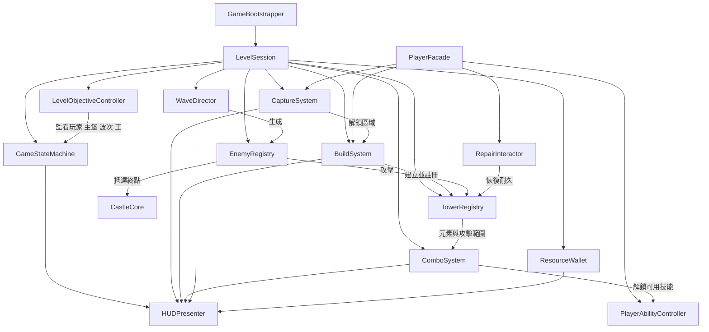
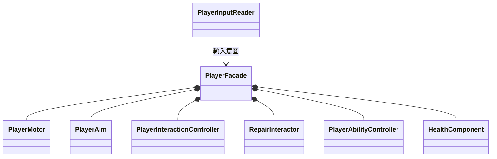
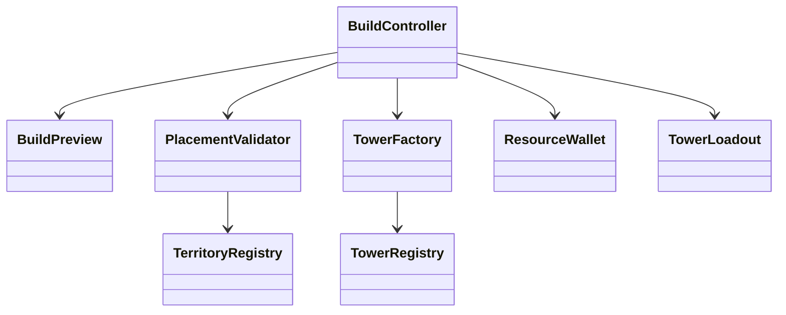
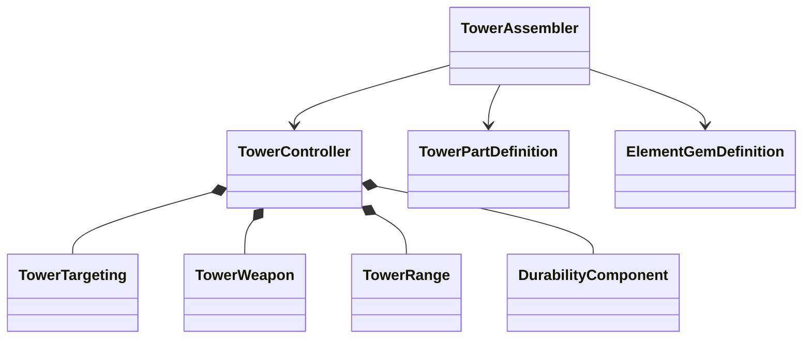

# CyberWizard TD 程式開發規劃

## 1. 文件目的

本文件將遊戲企劃轉換成可實作的 Unity 程式架構，供程式開發、Prefab 組裝、關卡串接與測試使用。

目前專案使用 Unity 2022.3.62f3、Universal Render Pipeline 14，尚未建立正式遊戲腳本。近期目標是先完成一個包含「佔領、建塔、塔耐久、元素連攜、敵人波次、關卡王、勝敗」的第一關垂直切片，再將相同架構複用到第二關。

## 2. 架構原則

### 2.1 採用的設計方向

- 使用元件組合，不用深層繼承。塔、敵人與玩家能力由小型元件組成。
- 使用 ScriptableObject 保存不會在執行中改變的設計資料，例如塔數值、敵人數值、波次與技能配方。
- 執行期狀態保留在一般 C# 物件或 MonoBehaviour，不回寫 ScriptableObject。
- 每個系統只公開必要介面，避免不同模組直接修改彼此的欄位。
- 系統內可使用 C# event；跨系統只傳遞有明確用途的事件，避免建立無限制的全域事件匯流排。
- 不使用大量 Singleton。由 `GameBootstrapper` 建立服務並注入需要它們的控制器。
- 第一版優先完成正確的遊戲循環，再增加存檔、複雜升級、完整物件池與編輯器工具。

### 2.2 分層

| 層級 | 責任 | 可依賴 |
|---|---|---|
| Core | 共用型別、介面、狀態機、事件資料 | 不依賴 Gameplay 與 UI |
| Data | ScriptableObject 定義與關卡設定 | Core |
| Gameplay | 玩家、佔領、建塔、塔、敵人、波次、連攜 | Core、Data |
| Infrastructure | 輸入、物件池、場景載入、NavMesh 包裝 | Core、Data |
| Presentation | UI、音效、特效、動畫顯示 | Core 與 Gameplay 的唯讀狀態或事件 |
| Bootstrap | 組裝所有系統、建立關卡工作階段 | 全部模組 |

核心規則不應寫進 UI、動畫事件或場景物件名稱中。UI 只顯示狀態並送出玩家意圖，實際規則由 Gameplay 系統判定。

## 3. 建議專案結構

```text
Assets/
  _Project/
    Art/
    Audio/
    Materials/
    Prefabs/
      Player/
      Towers/
      Enemies/
      World/
      UI/
      VFX/
    Scenes/
      Bootstrap.unity
      MainMenu.unity
      Level_01.unity
      Level_02.unity
    Scripts/
      Core/
        Combat/
        Events/
        StateMachine/
      Data/
        Abilities/
        Enemies/
        Levels/
        Towers/
      Gameplay/
        Building/
        Capture/
        Combat/
        Combo/
        Enemies/
        GameFlow/
        Player/
        Resources/
        Towers/
        Waves/
      Infrastructure/
        Input/
        Navigation/
        Pooling/
        Scenes/
      Presentation/
        Audio/
        Camera/
        UI/
        VFX/
      Bootstrap/
    Settings/
      Abilities/
      Enemies/
      Levels/
      Towers/
    Tests/
      EditMode/
      PlayMode/
```

建議建立以下 Assembly Definition，降低編譯耦合並防止反向依賴：

- `CyberWizard.Core`
- `CyberWizard.Data`
- `CyberWizard.Gameplay`
- `CyberWizard.Infrastructure`
- `CyberWizard.Presentation`
- `CyberWizard.Bootstrap`
- `CyberWizard.Tests.EditMode`
- `CyberWizard.Tests.PlayMode`

若建立 Assembly Definition 會拖慢第一週進度，可以先按照資料夾分層，待核心循環可玩後再補上。

## 4. 系統總覽



## 5. 遊戲流程架構

### 5.1 主要類別

| 類別 | 類型 | 責任 |
|---|---|---|
| `GameBootstrapper` | MonoBehaviour | 場景組裝點，建立服務並開始關卡，不承載遊戲規則 |
| `LevelSession` | 一般 C# 類別 | 保存本次關卡使用的系統參考與生命週期 |
| `GameStateMachine` | 一般 C# 類別 | 控制關卡狀態切換 |
| `LevelObjectiveController` | 一般 C# 類別 | 統一判斷勝利與失敗，不讓各系統自行載入場景 |
| `SceneLoader` | 服務 | 非同步切換 Bootstrap、選單與關卡場景 |
| `TimeController` | 服務 | 暫停與恢復遊戲，統一管理 `Time.timeScale` |

### 5.2 關卡狀態

```text
Loading
  -> Preparing
  -> Playing
       -> Paused -> Playing
       -> Victory
       -> Defeat
  -> Ending
```

- `Loading`：取得關卡定義、預載必要資產。
- `Preparing`：產生玩家、初始化 UI、註冊據點與波次。
- `Playing`：開放移動、佔領、建造、修理與技能。
- `Paused`：封鎖遊戲操作並顯示暫停 UI。
- `Victory`：所有波次完成且關卡王死亡。
- `Defeat`：玩家死亡或主堡生命值歸零。
- `Ending`：結算並準備重新開始或離開。

`LevelObjectiveController` 訂閱下列事件：

- `PlayerHealth.Died`
- `CastleCore.Destroyed`
- `WaveDirector.AllWavesCompleted`
- `BossController.Died`

只有它能呼叫 `GameStateMachine.RequestVictory()` 或 `RequestDefeat()`，避免同一幀重複結算。

## 6. 共用戰鬥模型

### 6.1 共用型別與介面

```csharp
public enum Team
{
    Player,
    Enemy,
    Neutral
}

public readonly struct DamageInfo
{
    public readonly float Amount;
    public readonly GameObject Source;
    public readonly Team SourceTeam;
    public readonly DamageType DamageType;
}

public interface IDamageable
{
    bool IsAlive { get; }
    void TakeDamage(in DamageInfo damage);
}

public interface ITargetable
{
    Transform AimPoint { get; }
    Team Team { get; }
    bool IsTargetable { get; }
}

public interface IRepairable
{
    float CurrentDurability { get; }
    float MaxDurability { get; }
    bool TryRepair(float amount);
}
```

### 6.2 `HealthComponent` 與 `DurabilityComponent`

- `HealthComponent` 用於玩家、敵人、關卡王與主堡。
- `DurabilityComponent` 用於防禦塔，實作 `IDamageable` 與 `IRepairable`。
- 兩者共用傷害資料格式，但分開命名，讓 UI 與規則能清楚區分生命及塔耐久。
- 數值到零時只發出一次死亡或失效事件。

塔每次成功攻擊後，由 `TowerWeapon` 呼叫 `DurabilityComponent.ConsumeAttackCost()`。不要把自我耗損偽裝成敵方傷害，否則受擊特效、仇恨與傷害統計會被錯誤觸發。

## 7. 玩家系統

### 7.1 類別拆分



| 類別 | 責任 |
|---|---|
| `PlayerFacade` | 對外提供玩家位置、生命、鎖定與操作啟用狀態，不塞入所有細節 |
| `PlayerInputReader` | 讀取鍵盤滑鼠並產生移動、視角、互動、建造、技能、閃避意圖 |
| `PlayerMotor` | 移動、重力、衝刺、閃避與碰撞 |
| `PlayerAim` | 從攝影機取得瞄準點，供建造與技能共用 |
| `PlayerInteractionController` | 選擇附近據點、塔或互動物 |
| `RepairInteractor` | 驗證距離、資源、冷卻後修理 `IRepairable` |
| `PlayerAbilityController` | 管理技能欄、冷卻與施放請求 |

目前專案未安裝新版 Input System。第一版可使用舊版 Input Manager，但 `PlayerInputReader` 必須是唯一讀取 `Input` API 的類別，其他遊戲程式不得直接呼叫 `Input.GetKey`。之後若換成新版 Input System，只需替換輸入層。

## 8. 佔領系統

### 8.1 類別

| 類別 | 責任 |
|---|---|
| `TerritoryZone` | 表示一個可佔領區塊，持有邊界、據點與建造區域參考 |
| `CapturePoint` | 追蹤範圍內玩家、累積佔領進度、顯示世界提示 |
| `CaptureSystem` | 保存所有區域的佔領狀態並發出區域解鎖事件 |
| `CaptureState` | `Locked`、`Available`、`Capturing`、`Captured` |
| `TerritoryRegistry` | 以穩定 ID 查詢區域，供建造與存檔使用 |

### 8.2 流程

```text
玩家進入 CapturePoint
  -> CapturePoint 確認關卡處於 Playing
  -> 開始累積進度
  -> 玩家離開時依設定暫停或倒退
  -> 進度完成
  -> CaptureSystem.MarkCaptured(zoneId)
  -> TerritoryZone 開啟建造權與視覺狀態
  -> BuildSystem 收到 TerritoryCaptured 事件
  -> UI 顯示區域已解鎖
```

第一版建議已佔領區域不會被敵人奪回，以降低關卡與 AI 複雜度；類別仍保留狀態切換能力，日後可以新增 `Contested` 與敵方佔領規則。

## 9. 建造系統

### 9.1 類別關係



| 類別 | 責任 |
|---|---|
| `BuildController` | 建造模式狀態機，接收選塔、移動預覽、旋轉、確認與取消 |
| `BuildPreview` | 顯示透明模型、碰撞範圍與有效或無效材質 |
| `PlacementValidator` | 集中執行所有放置規則並回傳失敗原因 |
| `TowerFactory` | 依配置建立塔並注入部件、元素與必要服務 |
| `TowerRegistry` | 追蹤目前所有塔、數量上限與移除事件 |
| `TowerLoadout` | 玩家這一關可使用的塔部件與寶石選擇 |
| `ResourceWallet` | 保存本關資源並提供原子性的 `TrySpend` |

### 9.2 放置驗證順序

`PlacementValidator.Validate(BuildRequest)` 應依序檢查：

1. 是否命中允許建造的地面層。
2. 坡度是否在允許範圍。
3. 是否位於已佔領的 `TerritoryZone`。
4. 是否碰到敵人道路、主堡、據點、其他塔或障礙物。
5. 是否超過關卡塔數上限。
6. 資源是否足夠。

驗證結果應包含 `IsValid` 與 `BuildFailureReason`，讓 UI 能顯示「區域未佔領」「資源不足」等明確原因。

確認建造時先再次驗證，再以 `ResourceWallet.TrySpend(cost)` 扣款，成功後才由 `TowerFactory` 建立塔。若生成失敗，必須退回資源。

## 10. 防禦塔系統

### 10.1 聚合結構



| 類別 | 責任 |
|---|---|
| `TowerController` | 塔的外觀入口與啟用狀態，協調子元件 |
| `TowerAssembler` | 將塔底、塔身、塔頂與寶石資料合成 `TowerRuntimeStats` |
| `TowerTargeting` | 在範圍內選擇目標，不處理傷害 |
| `TowerWeapon` | 攻擊冷卻、瞄準、產生投射物或直接命中、扣除攻擊耐久 |
| `TowerRange` | 提供攻擊半徑與連攜範圍查詢 |
| `DurabilityComponent` | 被攻擊、自我耗損、修理與失效 |
| `TowerVisual` | 根據三個部件資料組裝模型與動畫 |

### 10.2 資料定義

```csharp
public enum TowerPartSlot
{
    Base,
    Body,
    Top
}

public enum ElementType
{
    None,
    Fire,
    Water,
    Wind,
    Earth
}
```

`TowerPartDefinition : ScriptableObject` 建議包含：

- 唯一 ID 與顯示名稱。
- 部件槽位。
- 模型 Prefab。
- 成本修正。
- 耐久、傷害、射程、攻速等加成。
- 可選的攻擊行為 Prefab 或策略 ID。

`ElementGemDefinition : ScriptableObject` 建議包含：

- 元素種類。
- 顯示圖示、材質與特效。
- 元素傷害或狀態效果修正。

`TowerRuntimeStats` 是建造時產生的不可變快照。執行中不可直接讀 ScriptableObject 後又修改它，否則多座塔會共享被污染的資料。

### 10.3 耐久歸零的暫定規則

為了讓第一版可實作，建議暫定：

- 耐久歸零後塔進入 `Disabled`，停止攻擊與提供連攜範圍。
- 模型保留在場上，可由玩家修理至最低啟用門檻後恢復。
- 失效塔仍占用塔數上限與空間。

這比直接摧毀更能凸顯修理玩法，也不需要處理玩家因塔突然消失而失去投資的挫折。企劃若決定改成摧毀，只需替換 `TowerDestroyedPolicy`。

## 11. 元素連攜系統

### 11.1 資料與服務

| 類別 | 類型 | 責任 |
|---|---|---|
| `ComboRecipeDefinition` | ScriptableObject | 定義無順序元素組合、技能、圖示與顯示名稱 |
| `ComboAbilityDefinition` | ScriptableObject | 冷卻、範圍、效果列表與施放表現 |
| `ComboSystem` | 服務 | 根據瞄準位置與有效塔範圍判定可用連攜 |
| `TowerRangeQuery` | 服務 | 查詢指定位置被哪些有效塔覆蓋 |
| `ComboCandidate` | 值物件 | 包含兩座塔、元素配方與可施放區域 |
| `AbilityExecutor` | 服務 | 驗證並執行技能效果 |
| `IAbilityEffect` | 介面 | 傷害、持續傷害、擊退、緩速等效果的共同入口 |

### 11.2 判定方式

第一版不需要預先產生複雜的幾何交集物件。施放時對玩家瞄準的世界座標執行查詢即可：

```text
取得瞄準點
  -> TowerRangeQuery 找出覆蓋該點的所有有效塔
  -> 過濾 Disabled 或不同陣營的塔
  -> 將元素兩兩配對並正規化順序
  -> ComboSystem 查找 ComboRecipeDefinition
  -> 回傳可用技能清單
  -> 玩家選擇或按下對應技能鍵
  -> 再次驗證塔、位置、冷卻與消耗
  -> AbilityExecutor 施放
```

元素配對必須是無順序的，例如 `Fire + Wind` 與 `Wind + Fire` 應得到同一個 `ElementPairKey`。

若一個位置同時被三座以上的塔覆蓋，第一版可讓 UI 顯示所有合法兩兩組合；若操作過於複雜，再改為依技能欄或玩家選取的兩座塔決定。

### 11.3 技能效果組合

建議讓 `ComboAbilityDefinition` 持有一組效果定義，而不是為每個技能建立完全不同的控制器：

- `AreaDamageEffect`
- `DamageOverTimeEffect`
- `SlowEffect`
- `KnockbackEffect`
- `SpawnZoneEffect`

三個初期連攜可以重用這些效果。只有行為真的特殊時才建立專屬 Ability 類別。

## 12. 敵人與導航系統

### 12.1 敵人元件

| 類別 | 責任 |
|---|---|
| `EnemyController` | 對外入口，協調移動、目標與攻擊狀態 |
| `EnemyStateMachine` | `Move`、`AttackTower`、`AttackCore`、`Stunned`、`Dead` |
| `EnemyNavigator` | 封裝 NavMeshAgent，前往下一個路點或目標 |
| `EnemyTargetSensor` | 尋找可攻擊的塔，避免每隻敵人每幀全場搜尋 |
| `EnemyAttack` | 攻擊冷卻與傷害輸出 |
| `EnemyRegistry` | 註冊活著的敵人，供波次與範圍技能查詢 |
| `GoalTrigger` | 敵人抵達終點時對主堡造成傷害並移除敵人 |
| `EnemyDefinition` | 敵人數值、模型、Prefab、獎勵與攻擊設定 |

### 12.2 AI 優先順序

第一版建議採用可預測規則：

1. 沿 NavMesh 或路點前往主堡。
2. 若可攻擊半徑內出現有效塔，選擇最近的塔。
3. 停止移動並攻擊，直到塔失效或離開範圍。
4. 回到原路線繼續前進。
5. 抵達終點後對主堡造成傷害並退場。

避免第一版導入行為樹。簡單狀態機已足以支援目前企劃，且較容易除錯。

## 13. 波次與關卡王

### 13.1 資料定義

```text
LevelDefinition
  - levelId
  - sceneName
  - startingResources
  - towerLimit
  - captureSettings
  - WaveDefinition[]
  - bossDefinition

WaveDefinition
  - SpawnGroup[]
  - preparationTime
  - completionDelay

SpawnGroup
  - enemyDefinition
  - count
  - interval
  - spawnPointId
  - startDelay
```

### 13.2 執行類別

| 類別 | 責任 |
|---|---|
| `WaveDirector` | 管理準備期、生成期、清場等待與下一波 |
| `EnemySpawner` | 從指定出生點取得或建立敵人 |
| `SpawnPointRegistry` | 以 ID 對應場景出生點，避免資料資產直接引用場景物件 |
| `BossController` | 關卡王專屬階段與事件，仍使用共用生命及傷害介面 |
| `WaveHUDPresenter` | 顯示波次、倒數、剩餘敵人與王血條 |

`WaveDirector` 只有在該波所有 SpawnGroup 都生成完畢，且 `EnemyRegistry` 中屬於該波的敵人全部死亡或退場後，才算完成該波。最後一波結束後生成關卡王；關卡王死亡才通知目標系統勝利。

## 14. 資源系統

### 14.1 類別

- `ResourceWallet`：保存本關資源，提供 `CanAfford`、`TrySpend`、`Add` 與 `Changed`。
- `RewardService`：依敵人、波次或佔領結果發放資源。
- `BuildCostCalculator`：根據塔部件與寶石計算建造價格。
- `RepairCostCalculator`：若修理需要資源，依缺少耐久計算費用。

所有扣款都必須透過 `TrySpend` 完成，禁止先讀餘額再分兩步扣款，以免同一幀多個操作造成負數。

企劃尚未決定資源來源。為完成第一版，建議使用以下最小規則：

- 關卡開始提供基本資源。
- 擊殺敵人提供少量資源。
- 完成一波提供固定獎勵。
- 佔領區域不收費，避免核心流程被經濟卡死。

## 15. UI 與顯示層

### 15.1 Presenter 清單

| 類別 | 顯示內容 |
|---|---|
| `PlayerHUDPresenter` | 玩家生命、技能冷卻、互動提示 |
| `BuildHUDPresenter` | 塔選擇、成本、塔數上限、無效放置原因 |
| `ResourceHUDPresenter` | 資源餘額與變動動畫 |
| `CaptureHUDPresenter` | 目前據點、佔領進度與狀態 |
| `TowerHUDPresenter` | 選中塔的元素、耐久、攻擊範圍與修理提示 |
| `ComboHUDPresenter` | 當前瞄準點可使用的連攜與冷卻 |
| `WaveHUDPresenter` | 波次、倒數、敵人數量、王血條 |
| `ResultScreenPresenter` | 勝利、失敗、重試與離開 |

Presenter 訂閱狀態事件，不應在 `Update` 中每幀重新搜尋場景物件。世界空間範圍圈、佔領圈與建造預覽可獨立成 View 元件，由 Gameplay 提供狀態。

## 16. 事件與相依關係規範

### 16.1 建議事件

| 發送者 | 事件 | 主要接收者 |
|---|---|---|
| `CaptureSystem` | `TerritoryCaptured` | Build、UI、Reward |
| `ResourceWallet` | `Changed` | Resource UI、Build UI |
| `TowerRegistry` | `TowerAdded`、`TowerRemoved` | Combo、UI |
| `DurabilityComponent` | `Changed`、`Disabled`、`Reactivated` | Tower、UI、Combo |
| `ComboSystem` | `CandidatesChanged` | Combo UI |
| `WaveDirector` | `WaveStarted`、`WaveCompleted`、`AllWavesCompleted` | UI、Objective |
| `EnemyRegistry` | `EnemyAdded`、`EnemyRemoved` | WaveDirector、UI |
| `HealthComponent` | `Changed`、`Died` | UI、Objective、Reward |
| `GameStateMachine` | `StateChanged` | Input、UI、Audio |

### 16.2 規則

- 事件名稱使用已發生的過去式語意，例如 `TowerAdded`。
- 命令使用方法呼叫，例如 `TryBuild`、`TryCast`，不要用事件要求另一系統執行關鍵交易。
- 訂閱者在 `OnDisable`、`Dispose` 或關卡結束時解除訂閱。
- 事件資料使用小型不可變 struct 或 record，不傳出可任意修改的內部集合。
- 不透過 `FindObjectOfType`、Tag 或物件名稱完成模組依賴。

## 17. 場景與初始化

### 17.1 場景配置

- `Bootstrap.unity`：常駐服務、場景載入、音訊與全域 UI 根節點。
- `MainMenu.unity`：選關與設定，可延後製作。
- `Level_01.unity`：地形、NavMesh、據點、道路、出生點、主堡。
- `Level_02.unity`：第二關內容，重用同一套 Gameplay Prefab。

### 17.2 初始化順序

```text
GameBootstrapper.Awake
  -> 建立或取得 Infrastructure 服務
  -> 載入 LevelDefinition
  -> 建立 LevelSession
  -> 註冊場景內 Territory、SpawnPoint、CastleCore
  -> 初始化 Resource、Tower、Enemy、Combo、Wave 系統
  -> 綁定 UI Presenter
  -> 驗證必要參考
  -> GameStateMachine 進入 Preparing
  -> 生成或啟用玩家
  -> 進入 Playing
```

初始化驗證失敗時應清楚列出缺少的物件或重複 ID，並中止開局；不要讓空參考拖到戰鬥中才發生。

## 18. Prefab 組成建議

### 18.1 玩家 Prefab

```text
Player
  PlayerFacade
  CharacterController
  PlayerMotor
  PlayerAim
  PlayerInteractionController
  RepairInteractor
  PlayerAbilityController
  HealthComponent
  Animator
  ModelRoot
```

### 18.2 塔 Prefab

```text
Tower
  TowerController
  TowerAssembler
  TowerTargeting
  TowerWeapon
  TowerRange
  DurabilityComponent
  TowerVisual
  ModelRoot
    BaseSocket
    BodySocket
    TopSocket
```

### 18.3 敵人 Prefab

```text
Enemy
  EnemyController
  EnemyStateMachine
  EnemyNavigator
  EnemyTargetSensor
  EnemyAttack
  HealthComponent
  NavMeshAgent
  Animator
  ModelRoot
```

## 19. 效能與穩定性

第一版即應遵守：

- 物理 Layer 分開設定 Player、Enemy、Tower、BuildSurface、Road、CapturePoint、Projectile。
- 範圍查詢使用 `Physics.OverlapSphereNonAlloc` 或維護中的 Registry，不在每個物件每幀配置陣列。
- 敵人感知以固定間隔更新，例如每 0.2 秒，不必每幀搜尋。
- 投射物與高頻特效接入簡單物件池；塔與敵人可在數量確定後再決定是否池化。
- 快取元件參考，不在 Update 中使用 `GetComponent`、`Find` 或 LINQ。
- ScriptableObject 使用穩定字串 ID，場景物件使用可檢查重複的 `SerializableGuid` 或手動 ID。
- 公開欄位改用 `[SerializeField] private`，並在 `OnValidate` 檢查負數、空參考與錯誤範圍。

## 20. 測試計畫

### 20.1 EditMode 測試

- `ResourceWallet` 不會扣成負數，失敗交易不改變餘額。
- 無順序的元素組合可正確查到同一配方。
- `TowerAssembler` 能正確合併部件與寶石數值。
- `GameStateMachine` 不允許非法狀態跳轉。
- `LevelObjectiveController` 只結算一次。
- 波次完成條件不會在尚有活敵時成立。
- 修理不超過最大耐久，失效塔達門檻後可重新啟用。

### 20.2 PlayMode 測試

- 未佔領區域不能建塔，佔領後可建塔。
- 道路與其他塔上不能放置。
- 成功建塔只扣一次資源並增加塔數。
- 塔可選敵、攻擊、消耗自身耐久並在歸零後停止。
- 兩座對應元素塔覆蓋同一瞄準點時，技能可用；移出範圍後不可用。
- 敵人會攻擊擋路塔，塔失效後繼續前進。
- 敵人抵達終點會傷害主堡。
- 玩家死亡或主堡歸零會失敗。
- 最後一波結束、王死亡後才勝利。

## 21. 開發階段與交付順序

目前距離企劃中的 2026 年 11 月 24 日可玩版時間很短，程式工作應依「先閉環，再擴充」排序。

### 階段 A 核心骨架

交付內容：

- 建立 `_Project` 目錄與命名空間。
- 建立 `GameBootstrapper`、`LevelSession`、遊戲狀態機。
- 完成輸入、第三人稱移動、相機與玩家生命。
- 建立共用 `IDamageable`、Health、Durability。
- 建立 LevelDefinition 與最小測試場景。

完成條件：玩家能在測試場景移動、暫停、死亡並重新開始。

### 階段 B 第一個戰鬥閉環

交付內容：

- 單一塔 Prefab、選敵、攻擊與耐久耗損。
- 單一敵人、導航、攻塔、抵達終點。
- 主堡生命與勝敗判定。
- 一波敵人的 `WaveDirector`。

完成條件：不含佔領與連攜，也能完成一次塔防勝敗流程。

### 階段 C 企劃核心特色

交付內容：

- 據點佔領與區域建造權。
- 建造預覽、放置驗證、資源與塔數上限。
- 塔元素與攻擊範圍顯示。
- 兩塔範圍查詢與一招完整連攜。
- 玩家修理塔。

完成條件：玩家能佔領、建塔、形成範圍重疊、施放連攜並修理塔。

### 階段 D 第一關垂直切片

交付內容：

- 三種連攜技能。
- 至少兩種普通敵人。
- 多波次與波次休息時間。
- 一名功能簡化的關卡王。
- 基本 HUD、音效、特效與結果畫面。
- 第 1 關完整流程及 PlayMode 冒煙測試。

完成條件：從進入第一關到勝利或失敗，不需開啟 Inspector 或重載場景即可完整遊玩。

### 階段 E 完成版擴充

交付內容：

- 第二關與新敵人配置。
- 塔部件差異與必要平衡。
- UI、音效、VFX、效能與錯誤處理完善。
- 只有前述內容穩定後才評估第三關。

## 22. 第一版範圍控制

為提高準時完成機率，可玩版先限制為：

- 一名玩家角色。
- 一個塔的核心攻擊行為，部件先提供數值與外觀差異。
- 四種元素，但只實作企劃指定的三種連攜。
- 一種資源。
- 一種修理方式。
- 兩種普通敵人與一名關卡王。
- 一張完整關卡。
- 已佔領區域不會被奪回。
- 不做永久成長、裝備背包、存檔、多人連線、行為樹或複雜技能編輯器。

## 23. 需要企劃優先確認的程式阻塞項目

以下決策若未確認，程式可以先採用本文件的暫定值，但應盡快定案：

1. 塔耐久歸零是失效可修、直接摧毀，還是自動重建。
2. 塔底、塔身、塔頂各自影響哪些數值或行為。
3. 火風、火地、水風三招技能的實際效果。
4. 每次攻擊消耗多少塔耐久，以及修理速度與成本。
5. 資源的來源、建塔成本與波次獎勵。
6. 每關塔數上限與波次數量。
7. 敵人是否一定攻擊路旁的塔，以及選擇目標的規則。
8. 連攜技能是瞄準地面施放、角色周圍施放，或從 UI 選取交疊區。
9. 玩家死亡是否立即失敗，是否存在倒地或復活機制。
10. 關卡王是否遵循道路，以及它與塔、玩家、主堡的互動方式。

## 24. 程式完成定義

每一項功能在符合以下條件後才視為完成：

- 規則不依賴場景物件名稱或 Inspector 手動執行順序。
- Prefab 必要參考已設定且有 `OnValidate` 或啟動檢查。
- 正常流程、取消流程、資源不足與物件被提前摧毀都能處理。
- UI 能顯示成功、不可用與失敗原因。
- 不留下持續出現的 Error、Exception 或 Missing Reference。
- 核心純邏輯有 EditMode 測試，跨元件流程至少有一個 PlayMode 冒煙測試。
- 新數值可透過 ScriptableObject 調整，不需要修改程式碼。

## 25. 建議最先建立的程式清單

依實作順序建立：

1. `Team`、`DamageInfo`、`IDamageable`、`IRepairable`。
2. `HealthComponent`、`DurabilityComponent`。
3. `GameStateMachine`、`LevelObjectiveController`。
4. `PlayerInputReader`、`PlayerMotor`、`PlayerFacade`。
5. `EnemyDefinition`、`EnemyController`、`EnemyNavigator`、`EnemyAttack`。
6. `TowerController`、`TowerTargeting`、`TowerWeapon`、`TowerRange`。
7. `EnemyRegistry`、`TowerRegistry`、`WaveDirector`。
8. `TerritoryZone`、`CapturePoint`、`CaptureSystem`。
9. `ResourceWallet`、`BuildController`、`PlacementValidator`、`TowerFactory`。
10. `ElementType`、`ComboRecipeDefinition`、`TowerRangeQuery`、`ComboSystem`。
11. `PlayerAbilityController`、`AbilityExecutor` 與第一招連攜效果。
12. HUD Presenter、關卡王與第一關內容串接。

這個順序會先得到可測試的戰鬥，再加入本作最關鍵的佔領與元素連攜，避免所有系統同時開工卻沒有可玩的整體流程。
