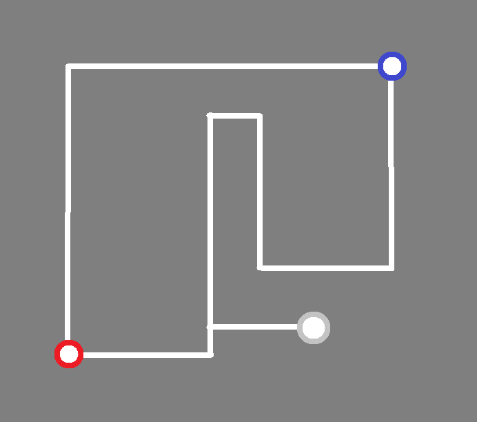

[Bug]
1. 上次將物件加上物理重力為了解決移動物件漂浮，但是出現新的問題 移動物件在碰到地面後瞬間往上跳。需要讓這些物件能穩定貼著地面

[Feature]
1. 塔在瞄準物件的過程需要透過一條線連接攻擊目標的中心，線的實作技術越簡單越好，顏色使用白色
2. 玩家的基礎移動加上跳躍 (空白鍵觸發)，持續按著不能連續跳躍
3. 玩家建造塔的距離有限制，最遠只能在離自己半徑為5的圓邊界建造 (透過限制，讓尚未建造的塔物件不會超過這個範圍)

[others]
1. 考量到完成一個波次需要時間，目前的波次間隔太近，調整讓間隔加大
2. 所有敵方的移動速度稍微降低
3. 修改波次敵人可能會從多種不同的道路移動(視地圖設計)，如果敵人靠近中立陣營則會試圖去佔領(這部分是由關卡資料紀錄，一波次會有多梯敵人，每一梯的目的不同，但大致分為攻擊玩家基地、佔領中立陣營(若陣營已被佔領則改為攻擊玩家基地))

地圖概念修改成這樣：
白色為道路，敵方部隊只會沿著道路移動
紅色圓圈為敵方基地
藍色圓圈為玩家基地
灰色圓圈為中立陣營
